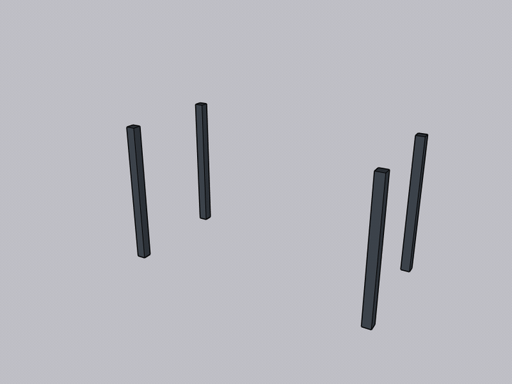
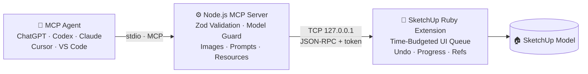

<div align="center">

# Ringo SketchUp MCP

[中文](README.md) · **English**

**Bring AI into SketchUp: inspect models, build geometry, edit safely, and verify visually.**

A local stdio MCP bridge connecting desktop SketchUp with MCP agents — generic, safe, and undoable.

[](https://github.com/Ringophilia/Ringo-Sketchup-MCP/actions/workflows/check.yml)
[](CHANGELOG.md)
[](LICENSE)
[](https://nodejs.org/)
[](docs/compatibility.md)
[](https://modelcontextprotocol.io/)

[Quick Start](#-quick-start) · [Connect Your Agent](#-connect-your-agent) · [Tools](#-tools) · [Multi-Instance](#-driving-multiple-sketchup-instances) · [Security](#-security--runtime-boundaries) · [Prompts](docs/prompts.md)

</div>

---



> 💬 *"Check the active SketchUp model first. Build a 1200 × 600 × 30 mm tabletop at Z = 720 mm, add four 40 × 40 mm legs with clear names, then frame the camera and show me the view."*
>
> From one prompt, the agent calls `model_get_info` → `entity_create_box` ×5 → `camera_set` → `view_capture`, builds the table in SketchUp, and brings the rendered PNG back into the chat.

## ✨ Highlights

<table>
<tr>
<td width="50%" valign="top">

### 🧩 Generic Typed Tools
37 typed tools covering queries, geometry creation, transforms, materials, tags, cameras, scenes, snapshots, and export. Tables, buildings, and mechanical parts share one API — no model-specific server hacks.

</td>
<td width="50%" valign="top">

### 👀 Visual Verification
`view_capture` requires no file path and returns a PNG directly as MCP image content so the agent can inspect and refine its own work.

</td>
</tr>
<tr>
<td valign="top">

### ↩️ Everything Is Undoable
Every write executes inside a readable SketchUp Undo transaction (`MCP: Create Box`, etc.). `batch_run` groups up to 100 steps into one atomic undo operation with step-level progress streaming.

</td>
<td valign="top">

### 🎯 Reference & Context Guards
`persistent_id`, full instance paths, model session IDs, and `active_path` guards protect every edit. Ambiguous shared-component IDs and locked ancestors are rejected before mutating.

</td>
</tr>
<tr>
<td valign="top">

### 🔒 Secure by Default
Listens only on `127.0.0.1` and authenticates every request with a random token. Arbitrary Ruby execution is disabled by default; logs never record tokens, parameters, or code.

</td>
<td valign="top">

### 🪟 Multi-Instance Isolation
Assign each SketchUp window its own profile (port, token, config file, and generated MCP server name) with persisted profile preferences and optional conflict auto-selection.

</td>
</tr>
</table>

## 🏗 Architecture



- **Node layer**: Implements standard MCP over stdio, validates parameters with Zod v4, tracks the active model session, streams progress notifications, and exposes Prompts and Resources.
- **Ruby layer**: Runs inside desktop SketchUp using non-blocking loopback I/O, drains queued tasks on a 30 ms UI tick budget, and wraps writes in Undo transactions.

## 📋 Requirements

| Component | Requirement |
|---|---|
| SketchUp | Desktop edition, 2021+ recommended (Web / iPad editions are not supported) |
| OS | Windows ✅ verified live on SketchUp 26.2.243<br/>macOS 🧪 shared Ruby implementation, path tests & CI; **physical macOS host acceptance pending** |
| Node.js | [22 or 24 LTS](https://nodejs.org/) |
| MCP Client | Any stdio MCP client |

## 🚀 Quick Start

**1. Prepare SketchUp & Node.js**: Install desktop SketchUp and Node.js 22/24, and **launch SketchUp once** so its user Plugins directory exists.

**2. Install via npm/npx (when published) or from source**

Option A — zero-clone setup via `npx`:

```sh
npx @ringo/sketchup-mcp setup
```

Option B — clone and build locally:

```sh
git clone https://github.com/Ringophilia/Ringo-Sketchup-MCP.git
cd Ringo-Sketchup-MCP
npm run setup
```

> On Windows you can also double-click `setup.cmd`; on macOS run `sh setup.command`.

The installer builds (when running from source), backs up any previous extension files, installs the Ruby extension, and generates credential-free client configuration snippets. Arbitrary Ruby execution remains **off** by default.

**3. Restart SketchUp, connect your agent, and run doctor**

```sh
npx @ringo/sketchup-mcp doctor   # or: npm run doctor
```

**4. Send your first prompt**

> Using sketchup MCP, call `model_get_info` to check the current model, then call `view_capture` to inspect the viewport.

More copy-paste examples are available in the [Prompt Library](docs/prompts.md) and [Usage Guide](docs/usage.md).

## 🔌 Connect Your Agent

Setup generates credential-free snippets under `.agent-config/` (source checkout) or your persistent config directory (`npx` mode):

| File | Clients |
|---|---|
| `codex.toml` | ChatGPT Desktop, Codex CLI, Codex IDE extension |
| `mcp.json` | Claude Desktop, Claude Code, Cursor |
| `vscode.json` | VS Code / GitHub Copilot |

<details>
<summary><b>Example snippet (mcp.json)</b></summary>

```json
{
  "mcpServers": {
    "sketchup": {
      "command": "npx",
      "args": ["-y", "@ringo/sketchup-mcp"],
      "env": {
        "SKETCHUP_MCP_CONFIG": "/absolute/path/to/RingoSketchUpMCP/config.json"
      }
    }
  }
}
```

</details>

See [docs/agents.md](docs/agents.md) for client-specific instructions and cloud vs. desktop boundaries.

## 🧰 Tools, Prompts & Resources

| Category | Capabilities |
|---|---|
| 🩺 Status & Model | `bridge_status` · `model_get_info` · `model_stats` |
| 🔍 Query & Selection | `entity_list` · `entity_inspect` · `selection_get` · `selection_set` |
| 🧱 Geometry | `entity_create_box` · `entity_create_cylinder` · `entity_create_mesh` · `entity_extrude` |
| ✏️ Editing | `entity_transform` · `entity_update` · `entity_delete` · `entity_duplicate` · `entity_group` · `entity_make_unique` |
| 🎨 Materials & Tags | `entity_set_material` · `materials_list` · `materials_set` · `tags_list` · `tags_set` |
| 🎥 Camera & Scenes | `camera_get` · `camera_set` · `scenes_list` · `scenes_set` |
| 🔁 Transactions & Diff | `batch_run` · `model_undo` · `model_redo` · `model_snapshot` · `model_diff` |
| 🖼 Views & Files | `view_capture` · `view_export` · `model_save` · `model_export` · `scene_clear` |
| 🧪 Advanced API | `sketchup_run_ruby` (disabled by default; isolated per-call evaluation context) |
| 💡 Prompt & Resources | Prompt `sketchup-modeling-workflow` · Resources `sketchup://model/info`, `sketchup://materials` |

Every tool declares a readable `title` and `outputSchema`, and returns `structuredContent`. `entity_create_cylinder` accepts unit-aware `radius` and `height` (`radius_mm` / `height_mm` kept as deprecated millimeter aliases). `selection_get`, `materials_list`, and `tags_list` support `limit` / `offset` pagination, and `model_diff` bounds each change list with `limit`, `counts`, and `truncated`.

## 🪟 Driving Multiple SketchUp Instances

```sh
npm run setup -- --profile project-a --name "Project A" --port 9876
npm run setup -- --profile project-b --name "Project B" --port 9877
```

1. Merge both generated server entries (`sketchup-project-a` and `sketchup-project-b`) into your MCP client configuration.
2. In each SketchUp window, open **Extensions → Ringo SketchUp MCP → Select Profile** (persisted across restarts), or enable **Auto-Select Free Profile on Conflict** in the same menu.
3. Have your LLM confirm `bridge_status` (`profile_id`, `profile_name`, and `port`) before writing to a model.

## 🔒 Security & Runtime Boundaries

- Loopback-only TCP (`127.0.0.1`), 32+ char token checked on handshake and every request, max 16 clients / 128 queued jobs / 4 MiB frames.
- **Timeouts (`-32003`) do not guarantee non-execution**: mutations are never replayed automatically. Check `bridge_status` and the model before retrying.
- Arbitrary Ruby evaluation (`sketchup_run_ruby`) runs with local user permissions and cannot be forcibly aborted; keep it disabled unless needed by a trusted local client.

## 🧪 Development & Verification

```sh
npm run check            # tsc --noEmit + Biome lint + tsc build + Node tests
npm run lint             # TypeScript + Biome lint check
npm run format           # Format bin/src/test/scripts with Biome
npm run test:coverage    # Node tests with coverage report
npm run check:ruby       # Ruby syntax check (supports RUBY env override)
npm run test:ruby        # Ruby contract tests (minitest; COVERAGE=1 for SimpleCov)
npm run package:rbz      # Package release/ringo-sketchup-mcp-<version>.rbz + .sha256
```

Live SketchUp host regressions: `npm run test:live`, `npm run test:references`, `npm run test:performance`, and `node scripts/security-test.mjs` (require a running desktop SketchUp with Ruby enabled and a disposable model).

## 📚 Documentation

| Document | Contents |
|---|---|
| [Prompt Library](docs/prompts.md) | Copy-pasteable bilingual modeling and debugging prompts |
| [Usage Guide](docs/usage.md) | Coordinates, nested paths, batches, pagination, troubleshooting |
| [Agent Setup](docs/agents.md) | Client configuration guides & desktop vs. cloud boundaries |
| [Compatibility](docs/compatibility.md) | Protocol negotiation, capability fallbacks, macOS notes |
| [Validation Notes](docs/validation.md) | First-hand test & live SketchUp regression evidence |
| [Publishing & Signing](docs/publishing.md) | npm publishing, tag releases, Trimble RBZ signing |
| [Improvement Plan](docs/improvement-plan.md) | Review findings and roadmap status |
| [Changelog](CHANGELOG.md) | Release history |

## 📄 License

[MIT License](LICENSE)
