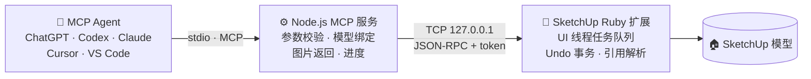

<div align="center">

# Ringo SketchUp MCP

**让 AI 走进你的 SketchUp：查询、建模、编辑，再亲眼看看结果。**

一座连接 MCP Agent 与桌面 SketchUp 的本地桥梁：通用、安全、可撤销。

[](https://github.com/Ringophilia/Ringo-Sketchup-MCP/actions/workflows/check.yml)
[](CHANGELOG.md)
[](LICENSE)
[](https://nodejs.org/)
[](docs/compatibility.md)
[](https://modelcontextprotocol.io/)

[快速开始](#-快速开始) · [接入 Agent](#-接入你的-agent) · [工具一览](#-工具一览) · [多开实例](#-同时驱动多个-sketchup) · [安全边界](#-安全与运行边界) · [常见问题](#-常见问题)

</div>

---

> 💬 *"先确认当前 SketchUp 模型。创建一个 1200 × 600 × 30 毫米的桌面，底部离地 720 毫米；再做四条 40 × 40 毫米的桌腿，起好名字，最后调整相机把视图给我看看。"*
>
> 只要说一句话，Agent 就会依次调用 `model_get_info` → `entity_create_box` ×5 → `camera_set` → `view_capture`，在你的 SketchUp 里搭出这张桌子，再把截图带回对话。

## ✨ 亮点

<table>
<tr>
<td width="50%" valign="top">

### 🧩 通用工具，不写死模型
37 个类型化工具，覆盖查询、几何创建、变换、材质、标签、相机、场景、导出等操作。桌子、房子、零件都使用同一套 API，不需要为某个特定模型改服务器代码。

</td>
<td width="50%" valign="top">

### 👀 让 AI 看得见
`view_capture` 不用指定保存路径，直接把 PNG 作为 MCP 图片返回。Agent 建完模型可以自己检查结果，发现问题再修改。

</td>
</tr>
<tr>
<td valign="top">

### ↩️ 一切皆可撤销
每次修改都是一个 SketchUp Undo 事务。`batch_run` 把最多 100 步操作合成一次撤销，中间任一步失败就整体回滚。

</td>
<td valign="top">

### 🎯 不会改错地方
`persistent_id`、完整实例路径、模型会话与编辑上下文共同守护每一次修改。共享组件的引用有歧义时直接拒绝，锁定的祖先也受到保护。

</td>
</tr>
<tr>
<td valign="top">

### 🔒 默认安全
只监听 `127.0.0.1`，每个请求都要校验随机 token。任意 Ruby 执行默认关闭；日志不记录 token、参数或代码。

</td>
<td valign="top">

### 🪟 多开不打架
用 profile 给每个 SketchUp 分配独立的端口、token 和 MCP 服务名，两个项目可以同时由 AI 驱动，互不串线。

</td>
</tr>
</table>

## 🏗 工作原理



- **Node 层**负责标准 MCP 协议：用 zod 校验全部参数，记住最近读取的模型会话，并把截图转换成 MCP 图片。
- **Ruby 层**运行在 SketchUp 内部：用非阻塞 I/O 接收请求，在 UI 线程上按队列执行，每次修改都包在 Undo 事务中。
- 两层通过带认证的回环 JSON-RPC 通信，协议主版本独立演进，次版本差异通过 capabilities 协商。

## 📋 环境要求

| 项目 | 要求 |
|---|---|
| SketchUp | 桌面版，推荐 2021 及以上（网页版、iPad 版不适用） |
| 操作系统 | Windows ✅ 已在 SketchUp 26.2.243 上完成实机回归<br/>macOS 🧪 安装路径、CI 与 Ruby 实现共用，**尚未完成实机验收** |
| Node.js | [22 或 24 LTS](https://nodejs.org/) |
| AI 客户端 | 任意支持 stdio MCP 的客户端 |

## 🚀 快速开始

**1. 准备环境**：安装桌面 SketchUp 和 Node.js，并**先启动一次 SketchUp**，让它生成用户插件目录。

**2. 获取代码并一键安装**

```sh
git clone https://github.com/Ringophilia/Ringo-Sketchup-MCP.git
cd Ringo-Sketchup-MCP
npm run setup
```

> Windows 也可以直接双击 `setup.cmd`；macOS 可以在终端运行 `sh setup.command`。

安装脚本会完成：安装依赖 → 构建服务 → 备份并安装扩展 → 生成本机客户端配置。Ruby 脚本执行默认关闭，普通建模和图片预览都不需要它。

**3. 重启 SketchUp，接入 Agent，运行体检**

```sh
npm run doctor
```

doctor 会逐项检查构建、配置、扩展文件、实时连接和版本匹配，任何一项失败都会给出下一步操作建议。

**4. 说出第一句话**

> 使用 sketchup MCP，先调用 `model_get_info` 告诉我当前模型，然后用 `view_capture` 看看当前视图。

能看到截图，就说明一切就绪 🎉。更多建模示例见 [使用指南](docs/usage.md)。

## 🔌 接入你的 Agent

`npm run setup`（或 `npm run config:agents`）会在 `.agent-config/` 下生成配置片段。片段中使用**绝对路径**，路径含空格或中文也没问题，并且**不包含 token**。

| 生成文件 | 适用客户端 |
|---|---|
| `codex.toml` | ChatGPT 桌面版、Codex CLI、Codex IDE 扩展 |
| `mcp.json` | Claude Desktop、Claude Code、Cursor 等使用 `mcpServers` 的客户端 |
| `vscode.json` | VS Code / GitHub Copilot |

<details>
<summary><b>配置示例（mcp.json）</b></summary>

```json
{
  "mcpServers": {
    "sketchup": {
      "command": "/absolute/path/to/node",
      "args": ["/absolute/path/to/Ringo-Sketchup-MCP/dist/mcp-server.js"]
    }
  }
}
```

</details>

各客户端的详细导入步骤，以及网页版、云端 Agent 的接入边界，见 [Agent 接入指南](docs/agents.md)。

> **能列出工具 ≠ 已连上 SketchUp。** 只有 `bridge_status` 调用成功，才说明 Node 服务已经和 SketchUp 握手。

## 🧰 工具一览

| 类别 | 工具 |
|---|---|
| 🩺 状态与模型 | `bridge_status` · `model_get_info` · `model_stats` |
| 🔍 查询与选择 | `entity_list` · `entity_inspect` · `selection_get` · `selection_set` |
| 🧱 几何创建 | `entity_create_box` · `entity_create_cylinder` · `entity_create_mesh` · `entity_extrude` |
| ✏️ 编辑 | `entity_transform` · `entity_update` · `entity_delete` · `entity_duplicate` · `entity_group` · `entity_make_unique` |
| 🎨 材质与标签 | `entity_set_material` · `materials_list` · `materials_set` · `tags_list` · `tags_set` |
| 🎥 相机与场景 | `camera_get` · `camera_set` · `scenes_list` · `scenes_set` |
| 🔁 事务与比较 | `batch_run` · `model_undo` · `model_redo` · `model_snapshot` · `model_diff` |
| 🖼 图片与文件 | `view_capture` · `view_export` · `model_save` · `model_export` · `scene_clear` |
| 🧪 高级 API | `sketchup_run_ruby`（默认关闭） |

每个工具都会返回 `structuredContent`。成功时包含数据、警告、任务 ID、执行耗时和排队耗时；失败时给出明确的错误码。`view_export` 生成的图片不超过 4 MiB 时，也会附带返回图片内容。

<details>
<summary><b>📐 模型操作约定（给 Agent 和开发者的要点）</b></summary>

<br/>

- **先读再改**：首次修改前调用 `model_get_info`。服务会记住模型会话，并为后续修改自动补上 `model_id`；切换模型后需要重新读取。创建、选择、分组这类依赖编辑上下文的操作还会检查 `active_path`。
- **单位**：输入和输出默认都是毫米。创建和增量变换使用父容器坐标；返回的 `transform` 是世界变换（列主序，平移使用请求的单位）。`matrix` 输入会替换局部变换，不要直接复用世界矩阵。
- **嵌套与共享**：嵌套实体使用完整 `path` 引用；`parent: {path: [...]}` 指定在哪个容器里创建。共享组件的同一个 ID 可能对应多个路径，这种情况下必须显式提供路径。修改共享定义会影响所有实例；想要独立修改，先对祖先调用 `entity_make_unique`，再重新查询。
- **批量**：`batch_run` 复用单个工具的参数校验和默认值，所有步骤在同一个 Undo 事务中执行，任一步失败就整体回滚。
- **大模型分页**：`entity_list` 默认取到一页就返回。`total_exact: false` 表示总数只是下界，沿 `next_offset` 继续翻页；需要精确总数时传 `include_total: true`。遇到数量上限或约 500 ms 的遍历预算时会返回 `truncated: true`，这时应缩小父级范围。
- **覆盖保护**：保存和导出默认不覆盖已有文件，需要显式设置 `overwrite: true`。

更多示例见 [使用指南](docs/usage.md)。

</details>

## 🪟 同时驱动多个 SketchUp

每个 profile 拥有独立的端口、token、配置文件和 MCP 服务名，两个 SketchUp 不会再争用 `9876` 端口。

```sh
npm run setup -- --profile project-a --name "Project A" --port 9876
npm run setup -- --profile project-b --name "Project B" --port 9877
```

1. 把 `.agent-config/project-a/` 和 `.agent-config/project-b/` 中的服务合并到客户端配置里，得到 `sketchup-project-a` 和 `sketchup-project-b` 两个服务。
2. 在每个 SketchUp 窗口中打开 **Extensions → Ringo SketchUp MCP → Select Profile**，选择对应的 profile。
3. 让 LLM 修改前先调用目标服务的 `bridge_status`，核对 `data.instance.profile_id` 和 `profile_name`。

> profile ID 只是你自定义的路由标签。各服务之间的 `model_id`、实体路径和快照不能互换，服务也不会根据前台窗口猜测目标。重复的端口会在安装时被直接拒绝。

## 🔒 安全与运行边界

| 方面 | 设计 |
|---|---|
| 网络 | 只监听 `127.0.0.1`，内部 TCP 端口不是 HTTP 端点 |
| 认证 | 握手和每个请求都校验随机 token（至少 32 位）；客户端配置中不包含 token |
| 资源上限 | 最多 16 个客户端、128 个排队任务，单帧 4 MiB |
| 排队保护 | 过期或已取消的任务不会执行；排队期间模型或编辑上下文发生变化时拒绝执行；不同客户端的取消请求互相隔离 |
| Ruby 执行 | 默认关闭；开启后以本机用户权限运行，**只应对可信客户端开放** |
| 日志 | 不记录 token、完整参数或 Ruby 代码 |

> ⚠️ **超时不等于操作没有执行。** 断线后服务不会自动重放修改。遇到超时，请先查看 `bridge_status` 中的最近任务和实际模型，再决定是否重试。正在运行的 Ruby 无法被安全地强制中止，不要提交可能无限循环的脚本。

快照只保存容器和根实体的元数据（最多 10,000 项，保留最近 10 个），不做逐顶点的几何比较。

## ⚙️ 配置

| 平台 | 默认配置文件 |
|---|---|
| Windows | `%APPDATA%/RingoSketchUpMCP/config.json` |
| macOS | `~/Library/Application Support/RingoSketchUpMCP/config.json` |
| 自定义 | 通过环境变量 `SKETCHUP_MCP_CONFIG` 指定 |

可以用环境变量覆盖：`SKETCHUP_PORT`、`SKETCHUP_TOKEN`、`SKETCHUP_TIMEOUT_MS`、`SKETCHUP_ENABLE_RUBY_EVAL`。Node 端的请求超时也可以写在配置文件的 `timeout_ms` 中（单位毫秒，范围 100–600000，默认 60000），环境变量优先。

> 从 Finder 启动的 Mac 应用通常不会继承 shell 环境变量，建议直接使用默认配置文件。

<details>
<summary><b>安装、升级与修复的更多选项</b></summary>

```sh
npm run setup -- --year 2026              # 指定 SketchUp 版本（默认选择最新版本）
npm run setup -- --plugins "/custom/Plugins"  # 自定义插件目录
npm run setup -- --dry-run                # 只显示安装计划，不修改任何文件
npm run setup -- --enable-ruby            # 开启完整 Ruby API（需要重启 SketchUp）
```

- 升级会完整备份旧扩展（loader 与实现目录），安装失败时自动恢复扩展和原配置。备份位于配置目录下的 `backups/`，安装完成后会打印具体位置。
- 移动项目目录或升级 Node 之后，重新运行 `npm run config:agents` 并更新客户端配置。
- 已有开发环境也可以分步执行：`npm ci` → `npm run build` → `npm run install:extension` → `npm run config:agents`。

```sh
npm run doctor                    # 完整体检
npm run doctor -- --json          # 机器可读输出
npm run doctor -- --offline       # 只检查安装文件，不能证明已连上 SketchUp
npm run doctor -- --profile project-a
```

通过 Extension Manager 手动安装 RBZ 的用户没有安装记录，可以用 `--plugins PATH` 指定检查位置。

</details>

## ❓ 常见问题

| 现象 | 处理方式 |
|---|---|
| 首次修改提示先读取模型 | 调用 `model_get_info`，确认标题和路径后再继续 |
| `-32007` 模型或编辑上下文变化 | 重新读取模型信息，重新确认目标 |
| `-32008` 引用失效或有歧义 | 用 `entity_list` 重新查询完整路径，不要猜 ID |
| `-32003` 超时或取消 | 查看 `bridge_status` 和实际模型，执行结果可能未知 |
| `-32005` 结果或查询过大 | 缩小父级范围，降低深度或图片尺寸 |
| 工具能列出但连不上 SketchUp | 打开桌面模型，确认扩展已启用，再运行 `npm run doctor` |
| doctor 提示版本不一致 | 运行 `npm run setup`，然后重启 SketchUp |
| doctor 提示认证失败 | 确认两端使用同一个配置目录，保留原 token，重启两端 |

完整的排错表见 [使用指南 · 常见错误](docs/usage.md#常见错误)。

## 🧪 开发与验证

```sh
npm run check            # 构建 + Node 测试
npm run check:ruby       # Ruby 语法检查（可用 RUBY 指定解释器）
npm run test:ruby        # Ruby 行为测试（需要 minitest）
npm run package:rbz      # 生成 RBZ 和 SHA-256 摘要到 release/
```

<details>
<summary><b>实机回归脚本（需要运行中的 SketchUp，并使用一次性测试模型）</b></summary>

```sh
npm run test:live          # 通用建模操作
npm run test:references    # 嵌套、共享组件、锁定、上下文切换
npm run test:performance   # 5000 实例大模型
node scripts/security-test.mjs
```

这些脚本需要根编辑上下文并开启 Ruby。它们会创建并清理 QA 对象，但会改变 Undo 历史和模型的修改标记。

</details>

CI 覆盖 **Windows / macOS / Linux × Node 22 / 24**，以及 **Ruby 2.7 / 3.2 / 3.3** 的语法与行为测试，但不运行 SketchUp 图形宿主。RBZ 在 Windows 和 macOS 上通用，Node 服务仍然需要保留。

## 📚 文档

| 文档 | 内容 |
|---|---|
| [使用指南](docs/usage.md) | 建模示例、坐标与嵌套、批量操作、大模型查询、错误处理 |
| [Agent 接入指南](docs/agents.md) | 各客户端的导入步骤与云端接入边界 |
| [兼容策略](docs/compatibility.md) | 版本原则、能力降级、macOS 说明 |
| [验证记录](docs/validation.md) | 每个版本的实机验收证据 |
| [提升计划](docs/improvement-plan.md) | 已知问题与后续路线图 |
| [更新日志](CHANGELOG.md) | 版本变更 |

## 🤝 参与贡献

欢迎提交 Issue、改进文档和发起 Pull Request，请先阅读 [贡献指南](CONTRIBUTING.md)。发现安全问题时，请通过 [私密漏洞报告](SECURITY.md) 联系，不要公开发布。

项目原则：**工具保持通用**；**仅限回环通信**；**认证必选**；**Ruby 执行需要显式开启**。

## 📄 许可证

[MIT License](LICENSE)：允许个人和商业使用，分发时请保留许可和版权声明。

<div align="center">
<sub>Made with ☕ for designers who'd rather describe than click.</sub>
</div>
